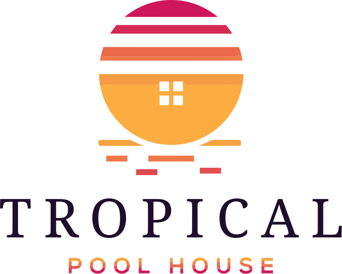

<p align="center">
  
</p>

# Tropical Poolhouse QC

Direct-booking website for Tropical Poolhouse QC, vacation rentals in Quezon City, Philippines: a private pool house for up to 20 guests and the Cubao Caveroom for up to 8. Built with Next.js, it pulls live property data, availability, rates and quotes from [Lodgify](https://www.lodgify.com) through server-side API routes and lets guests book directly.

[](LICENSE)
[](https://nextjs.org)
[](https://react.dev)
[](https://www.typescriptlang.org)
[](https://tailwindcss.com)

## Features

- Home page with hero search, property listings, recent bookings, testimonials, photo gallery and local things to do
- Property pages (`/tropical-poolhouse`, `/cubao-caveroom`) with an availability calendar, nightly rates calendar and price calculator
- Direct booking form that creates the reservation in Lodgify
- Currency switcher (PHP, USD, EUR, GBP, JPY, AUD, SGD, KRW) using approximate fixed rates
- SEO metadata with Open Graph and Twitter cards
- Animations with Framer Motion

## Tech stack

- [Next.js](https://nextjs.org) 16 (App Router) and React 19
- TypeScript
- Tailwind CSS 4
- Framer Motion
- Lodgify API (called server-side only; the API key never reaches the browser)

## Getting started

Requirements: Node.js 20+ and a Lodgify API key.

```bash
npm install
```

Create `.env.local` in the project root:

```bash
LODGIFY_API_KEY=your-lodgify-api-key
```

Then run the development server and open [http://localhost:3000](http://localhost:3000):

```bash
npm run dev
```

The Lodgify property and room-type IDs used by the site are set in `lib/constants.ts`.

## Scripts

| Command | Description |
|---|---|
| `npm run dev` | Start the development server |
| `npm run build` | Create a production build |
| `npm run start` | Serve the production build |
| `npm run lint` | Run ESLint |

There is no test suite yet.

## Project structure

```
app/
  page.tsx                  Home page
  all-properties/           Listing of all properties
  tropical-poolhouse/       Tropical Poolhouse QC property page
  cubao-caveroom/           Cubao Caveroom property page
  components/               UI sections (Hero, BookingSearch, PropertyDetail, PriceCalculator, ...)
  api/lodgify/              Server routes proxying Lodgify: properties, property,
                            availability, rates, rates-calendar, quote, search,
                            bookings, book
lib/constants.ts            Property list and Lodgify base URL
public/                     Logo, photos and partner logos
```

## Deployment

This is a standard Next.js app and deploys to [Vercel](https://vercel.com) or any Node.js host. Set `LODGIFY_API_KEY` as an environment variable on the host.

## License

The code is released under the [MIT License](LICENSE). MIT covers the code; the Tropical Poolhouse QC name and logo identify the project. The Airbnb and Booking.com logos in `public/` are trademarks of their respective owners.
